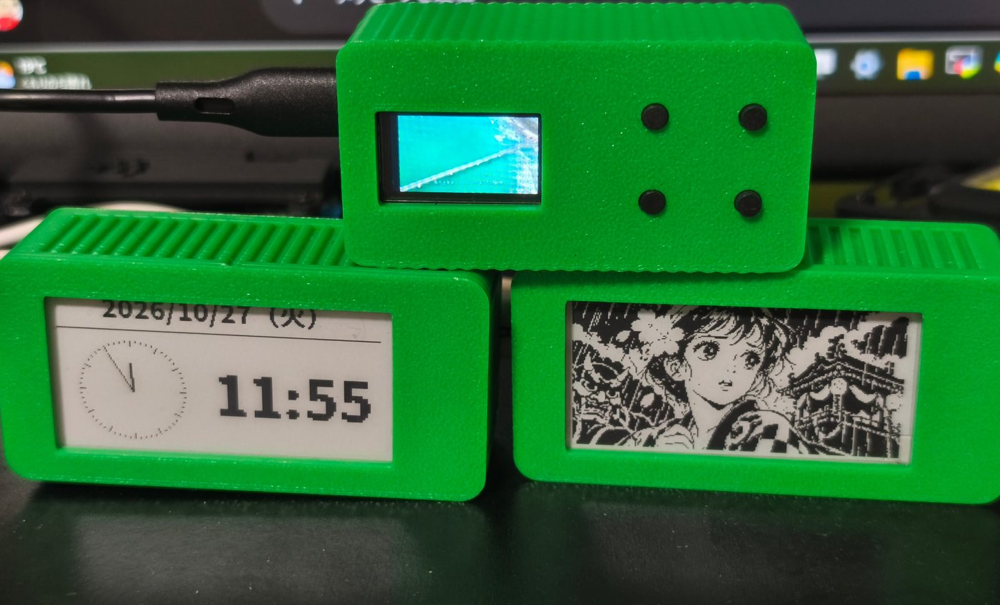
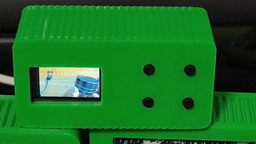
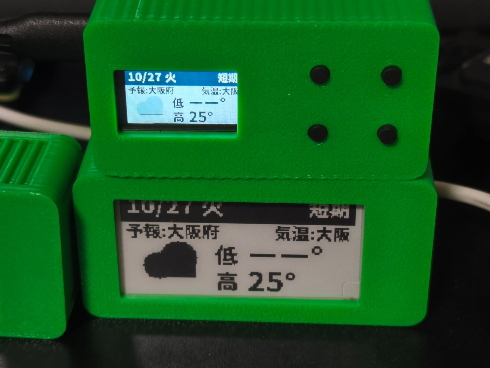
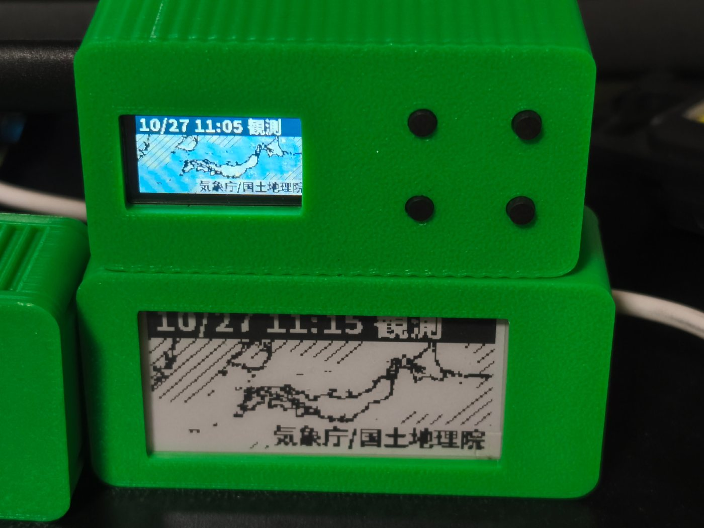
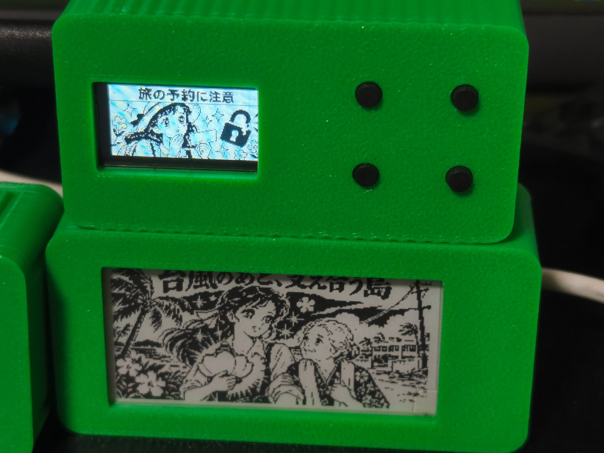
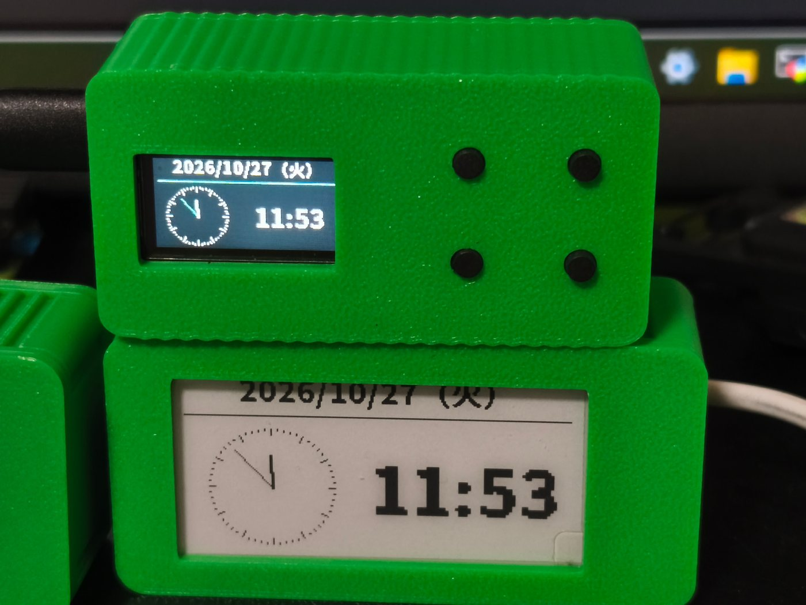

# PicoMado — 机の上に、自分だけの小さな窓を

[Read in English](README.md)

朝は天気をひと目。机に向かう時間は時計。気分を変えたいときには、動画や一枚の絵。PicoMado は、小さな画面に好きな役割を持たせて楽しむ、自作のデスクトップ端末です。組み立てて終わりではありません。プラグインを加えながら、自分の道具へ育てていけます。



*組み立てた 3 台。小さな画面と物理ボタンを、机で使う道具にしました。*

## 五つのプラグイン、五つの楽しみ

### YouTube — 机の片隅に、小さな動画の窓

PicoMado の Web UI で動画を選び、小さな LCD で再生します。風景を眺めたり、好きな映像を手元で楽しんだり。写真だけでは伝わらない、この小ささで動く楽しさをどうぞ。



*実機の LCD 再生を撮影した約 7 秒のループです。*

### 天気 — 出かける前に、ひと目

今日の天気と気温を、いつもの机に。見たい日の予報を切り替えて確認できます。カラー LCD と E-ink、それぞれの表情で表示します。



*同じ天気プラグインをカラー LCD と E-ink で表示しています。*

### 雨雲 — 空の様子を、小さな地図で

降水マップを表示し、時刻を切り替えて雨雲の様子をたどれます。天気予報とは違う、地図で見る楽しさを手元に。



*両方の画面に表示した雨雲レーダー。時刻と地図は撮影時の例です。*

### 風刺画 — 話題や言葉が、一枚の絵に

ニュースの話題や自分の文章から絵を生成し、PicoMado に飾れます。PicoMado の Web UI で簡単に設定できます。保存した作品を見返して、小さな画面を自分のギャラリーに。



*保存した作品を、二種類の画面に合わせて表示しています。*

### 時計 — いつもの机の、いつもの時計

日付と時刻を、アナログとデジタルで。ほかの機能を楽しむ合間も、机に置いて使える道具です。



*動作中の二種類の時計。日付と時刻は撮影時の表示例です。*

## 作った後も、楽しみが増える

まずは五つのプラグインから。自分のアイデアをプラグインにして、新しい役割を加えることもできます。表示するもの、操作するものを考えるところから、次の工作が始まります。[プラグイン作成ガイド](docs/guides/plugin-author.md)が入口です。

## 自分の一台を作ろう

カラー LCD と E-ink の作例を入口に、使いたい画面や操作に合わせた一台へ。[動作確認済みの構成と配線](docs/guides/hardware-support.md)から作り始められます。画面・ボタン・マイコンを変えてみたい人には、[カスタマイズガイド](docs/guides/customization.md)が変更場所と確認の進め方を案内します。

## 仕組み

```text
Web 操作 ──> Linux サーバ：プラグイン、表示内容、設定、保存した素材
                              │ Wi-Fi / WebSocket
                              ▼
                    Pico W：画面と物理ボタン
```

サーバが画像や動画を準備し、Pico W が受信・描画してボタン入力を伝えます。

## はじめ方

1. [ハードウェアガイド](docs/guides/hardware-support.md)で作り始める構成を選ぶ。
2. [初回設定ガイド](docs/guides/first-setup.md)に沿って Linux サーバと端末を準備する。
3. 既存端末を更新する場合は先に[退避と復旧](docs/guides/release-and-recovery.md)を読む。

詳しくは [ファームウェア](firmware/README.md)、[サーバ](service/README.md)、[文書案内](docs/README.md)を参照してください。開発ルールと証拠記録は [AGENTS.md](AGENTS.md)にあります。

コードは [MIT License](LICENSE)、著作権者は Tane Channel Technology です。フォントなど第三者の素材には[個別の権利表示](service/assets/NOTO-COPYRIGHT)が適用されます。
