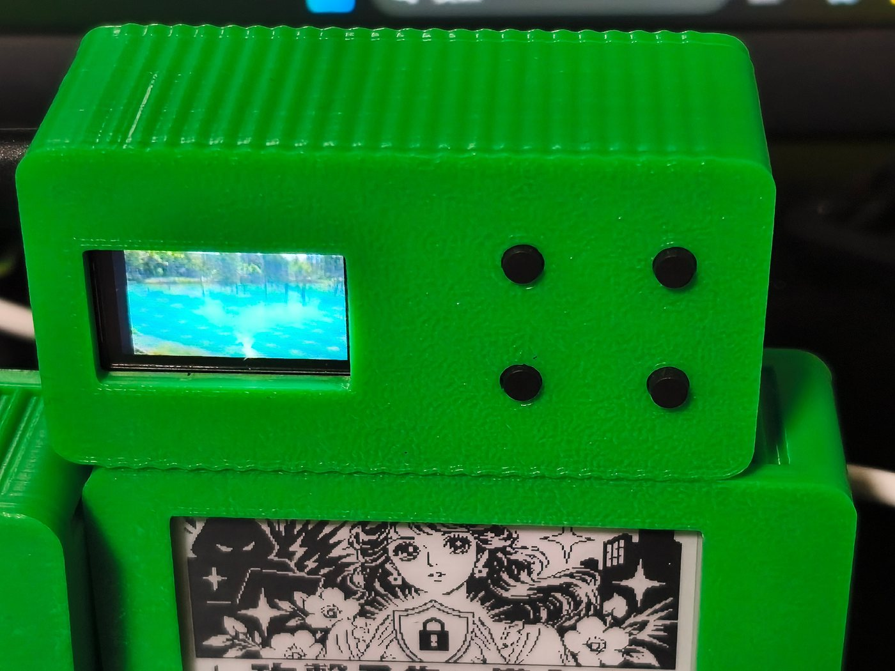

# PicoMado — 机の上に、自分だけの小さな窓を

[Read in English](README.md)

小さな画面と物理ボタンを備えた、机に置いて使う自分の道具を作れます。組み立てて終わりではありません。プラグインを増やして、表示するものや使い方を育てていけます。


*組み立てた 3 台を並べた写真です。それぞれ別のプラグインを表示しています。*

最初から五つの機能が入っています。

### 小さな LCD で YouTube

Web 画面で動画を選んでサーバで準備し、160×80 の LCD で再生します。保存した素材やフレームレート別の版もブラウザから管理できます。大画面の代わりではなく、小さな端末で動くことを楽しむ機能です。



*上の LCD で動画を再生中。下の E-ink 端末は別のプラグインを表示しています。*

### 机の上で天気をひと目

日本の天気予報を置き、端末の操作で日付をたどれます。サーバが気象庁の情報を更新し、別のアプリを開かずに確認できます。


*同じ天気プラグインをカラー LCD と E-ink で表示しています。*

### 時刻をたどれる雨雲レーダー

日本の降水マップを小さな画面で見て、利用できる時刻を切り替えられます。


*両方の画面に表示した雨雲レーダー。時刻と地図は撮影時の例です。*

### 作って見返せる風刺画

Web 画面でニュースの話題や自分の文章を指定して絵を生成します。完成した画像を端末に表示し、保存した作品を後から見返せます。生成にはサーバ側の別ツールと設定が必要です。


*保存した作品を、二種類の画面に合わせて表示しています。*

### 机に置く時計

日付、アナログ時計、24 時間表記の時刻を表示します。


*動作中の二種類の時計。日付と時刻は撮影時の表示例です。*

## 作った後も育てられる

画面、ボタン、ファームウェア、サーバ、Web 操作を組み合わせ、手元で使う一台にできます。新しい用途はサーバのプラグインとして実装できます。[プラグイン作成ガイド](docs/guides/plugin-author.md)が入口です。筐体の設計データは同梱されていないため、画面と配線に合うものを別途用意してください。

## 仕組み

```text
Web 操作 ──> Linux サーバ：プラグイン、表示内容、設定、保存した素材
                              │ Wi-Fi / WebSocket
                              ▼
                    Pico W：画面と物理ボタン
```

サーバが画像や動画を準備し、Pico W が受信・描画してボタン入力を伝えます。サーバと端末にはそれぞれ設定が必要です。機能によってはインターネット接続や追加のローカルツールを使います。

## 作る構成を選ぶ

対応プロファイルは Pico W と 160×80 ST7735S LCD・4 ボタン、または Pico W と 250×122 V4 E-ink・0／2 ボタンです。LCD 4 ボタンと E-ink 0 ボタンには実機確認記録があります。E-ink 2 ボタンの完成端末は実機受入が未完了です。部品を用意する前に[型番、配線、確認状況](docs/guides/hardware-support.md)を確認してください。Pico 2 W、別の画面、自由なボタン配置には対応していません。

## はじめ方

1. [ハードウェアガイド](docs/guides/hardware-support.md)で部品と配線を選ぶ。
2. [初回設定ガイド](docs/guides/first-setup.md)に沿って Linux サーバ、個体設定、正規ビルドと確認を進める。
3. 既存端末を更新する場合は先に[退避と復旧](docs/guides/release-and-recovery.md)を読む。

詳しくは [ファームウェア](firmware/README.md)、[サーバ](service/README.md)、[文書案内](docs/README.md)を参照してください。開発ルールと証拠記録は [AGENTS.md](AGENTS.md)にあります。

コードは [MIT License](LICENSE)、著作権者は Tane Channel Technology です。フォントなど第三者の素材には[個別の権利表示](service/assets/NOTO-COPYRIGHT)が適用されます。
