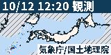
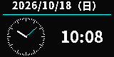

# PicoMado — a small window of your own

[日本語で読む](README.ja.md)

Build a little device for your desk, then keep making it yours. PicoMado puts a tiny screen and physical buttons in your hands. Its plugins give it something new to show long after the hardware is assembled.

PicoMado already has five built-in experiences:

### YouTube on a tiny LCD

Choose a video in the web interface, prepare it on the server, then watch it play on the 160×80 LCD. Saved sources and frame-rate variants can be managed in the browser. This feature uses the LCD; the small screen is part of the fun, not a replacement for a full-size player.

### Weather to glance at

Leave the Japanese forecast on your desk and use the device controls to browse its days. The server refreshes the forecast from JMA data; the screen gives you a quick view without opening another app.

### Rain radar you can step through

See a compact map of Japanese precipitation and move through the available times. The image below is an actual **software render preview** of the LCD output, not a device photo.



### Caricatures to make and revisit

Start a drawing from a news topic or your own words in the web interface. The finished image appears on the device, and you can browse saved work later. Generation requires separate server-side tools and settings.

### A clock that belongs on the desk

Show the date, an analog face and 24-hour time. The image below is an actual **software render preview** of the LCD output, not a device photo.



## Make it yours

The display, buttons, firmware, server and web controls form one device you can use at your desk. Add another use by implementing a server plugin through the [plugin guide](docs/guides/plugin-author.md). This repository does not include an enclosure design, so choose or build a housing for your particular screen and wiring.

## How it works

```text
Web controls ──> Linux server: plugins, content, settings and saved media
                            │ Wi-Fi / WebSocket
                            ▼
                  Pico W: screen and physical buttons
```

The server prepares images and media; the Pico W receives them, draws them and reports input. The server and device each have their own configuration. Some plugins need internet access or additional local tools.

## Choose a build

The supported profiles are Pico W with a 160×80 ST7735S LCD and four buttons, or Pico W with a 250×122 V4 E-ink display and zero or two buttons. The LCD four-button and E-ink zero-button builds have physical verification records. A complete E-ink two-button device has not yet passed physical acceptance. [Check exact parts, wiring and status](docs/guides/hardware-support.en.md) before buying or connecting components. Pico 2 W, other screens and arbitrary button layouts are not supported.

## Get started

1. Choose parts and wiring from the [hardware guide](docs/guides/hardware-support.en.md).
2. Follow the [first setup guide](docs/guides/first-setup.en.md) for the Linux server, device configuration, build and verification.
3. Use the [recovery guide](docs/guides/release-and-recovery.md) before updating an existing device.

For deeper detail, see the [firmware](firmware/README.md), [server](service/README.md) and [documentation index](docs/README.md). Development rules and evidence are in [AGENTS.md](AGENTS.md).

Code is licensed under [MIT](LICENSE), copyright Tane Channel Technology. Fonts and other third-party assets have [separate notices](service/assets/NOTO-COPYRIGHT).
