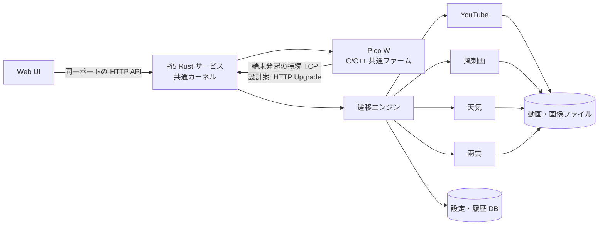

> 公開用注記: 本文のホームパス・ネットワーク値は匿名化した例示値です。時刻付き観測の原値や現在の設定先を示しません。

# ピコ窓 システム設計書ドラフト v0.4

- 作成日：2026-10-12 UTC
- 状態：構成・責務の設計案。初期ポート TCP 16153 と確認済み初期値を反映。LCD１台のサービス導入とHOME/AWAY接続実測は2026-10-13までの検証記録を参照。OS・ネットワーク設定変更は本書の指示外。
- 要件の正本：[全体・受入条件](../requirements/README.md)、[共通カーネル](../requirements/kernel.md)、[YouTube](../requirements/plugins/youtube.md)、[風刺画](../requirements/plugins/caricature.md)、[天気](../requirements/plugins/weather.md)、[雨雲レーダー](../requirements/plugins/rain-radar.md)

本文の「要件」は上記文書で合意済みの事項を指す。「設計案」はその実現方法であり、実測前に数値・ライブラリ・ファーム書込み手順を確定しない。初版の受入実機は LCD・４ボタン１台。複数端末を扱える構造は初版から設計し、E-ink と複数実機の確認は端末が用意された後に行う。既存の本番サービス、既存 E-ink 製品、ネットワーク設定は本書の対象外とする。

## 1. 構成と責務



Pi5 では単一 Rust サービスが Web/API と端末通信を同じポートで受ける。`systemd` は起動・監視に限り、端末のオンライン判定はサービスが行う。カーネルは端末 ID、能力、接続、選択プラグイン、共通入力モード、送信経路を管理する。プラグインは内容、取得・更新、固有設定、エラー描画、共有範囲、宛先を決める。カーネルは「同じプラグインの全端末に同じ内容を送る」と仮定しない。端末側は Wi-Fi 接続、待機、接続中表示、共通メニューの局所的な入力・描画を扱う。[R-03～R-05](../requirements/README.md#要件-id-と移動先受入条件の対応)

自宅では Pico から Pi5 の自宅 LAN へ直接 TCP 接続する。外出時は Pico からスマートフォンの TailSocks SOCKS5 へ接続し、同ノードから到達を確認した Pi5 宛先へ進む。2026-10-13の本環境では既存 subnet routing により LAN 宛先 `192.0.2.120:16153` を利用でき、追加 listener は不要だった。Tailnet参加だけでLAN到達を保証せず、別環境では経路受入・アクセス許可・対象待受を確認する。どちらも **Pico が発起した接続**上でサーバから画面を PUSH し、Pico が ACK を返す。外出接続方式（旧 U-19）は家 direct TCP／外 TailSocks として要件化済み。2026-10-11の実験は SOCKS5 認証後の TCP と PUSH/ACKまで、2026-10-13のLCD端末試験はLAN宛先のHTTP Upgrade、Hello、画像受信ACK・描画ACKまで確認した。長時間接続、動画帯域、HOME全操作の安定性は追加検証が必要。スマートフォンのテザリング全体を透過 VPN とみなさない。[接続技術ガイド](../guides/home-away-connectivity-technical-guide.md)、[R-05](../requirements/README.md#要件-id-と移動先受入条件の対応)

## 2. 遷移を契約で組み立てる

2026-10-20 の実装適合点、Pico の端末 API 境界、共通観測と USB／ホスト保存の分離は [契約と観測の段階的整理](../contracts-observation-design.md) に補足する。この節の Query／Rule／Transition／Effect の契約は変更しない。

ユーザー指定の [soukoban の `soukoban.py`](https://github.com/tanep3/soukoban/src/soukoban.py) に示された設計思想を、コードの移植先ではなく契約の参照元とする。提示された契約では `GameState` を `WorldQuery` で観測し、`Rule(WorldQuery, Position, Position)` が `Transition` 候補を遅延生成し、`Engine` が選択した純粋な `Transition(GameState) -> GameState` を適用する。PicoMado では座標の代わりに端末イベント・Web 操作・時刻・外部処理結果を入力とし、同じ分離を保つ。参照先のコード内容はローカルにないため、この契約説明を設計根拠とし、具体的な Rust trait 形状は実装前に検討する。

| 契約 | PicoMado での役割 | 禁止する結合 |
| --- | --- | --- |
| `WorldQuery` 相当 | 一貫した読み取り専用スナップショット。端末・接続・設定・対象プラグインの軽量状態を照会する。 | Query 内で DB 更新、ネットワーク送信、画面描画をしない。巨大なフレーム本体を状態へ複製しない。 |
| `Rule` 相当 | 入力イベントと Query から、適用条件・対象スコープ・優先度・効果を持つ候補を必要に応じて生成する。プラグインは自身の Rule 群を登録する。 | カーネルの巨大な種類別 `if` に各プラグインの表示・取得規則を集めない。 |
| `Transition` 相当 | 選択された候補が軽量な状態へ純粋な更新を適用し、新状態を返す。 | 遷移関数内で TCP 書込み、ファイル操作、CLI 起動をしない。 |
| `Engine` 相当 | ガードと現在の世代・改訂を再検査し、候補を決定的に選択・適用する。 | 遅れて届いた応答で新しいセッション、表示、設定を上書きしない。 |
| `EffectRunner`（本設計案） | 選択候補に付随する取得・保存・描画送信などの命令を状態確定後に実行し、結果を新しいイベントとして戻す。 | IO の完了順を状態遷移の正しさとして扱わない。 |

候補には `対象 aggregate`（端末、共通順序、またはプラグイン共有状態）、期待改訂・世代、適用理由を持たせる設計案とする。１ aggregate に同じイベントから複数候補がある場合、まず世代・能力・利用 ON・モードのガードで無効候補を除く。その後、**待機・削除・接続キャンセルなど状態保護の操作 → 明示的な利用者操作 → 定期更新**の順に選ぶ案とし、同順位の競合は勝手にランダム選択せず設計エラーとして記録する。異なる aggregate へ必要な操作は順序付きの後続イベントで表す。優先度と粒度は U-02・U-03・U-14 の設計レビューで固定する。

例：`ButtonNext(device_id)` ではカーネルの共通 Rule が現在の利用 ON 順序から次のプラグインを候補に出す。選択された遷移は選択 ID と `display_epoch` を更新し、選択先への表示依頼を効果として発行する。描画データを決める Rule は選択先プラグインにあり、エンジンはプラグイン ID の登録先へイベントを配送するだけで内容を解釈しない。旧プラグインの描画完了が後着しても、表示世代のガードで破棄する。[AC-05](../requirements/README.md#ac-05)、[AC-13](../requirements/README.md#ac-13)

天気の地域変更では設定改訂を進め、旧地域で進行中の取得結果を改訂違いとして無効化する。閲覧中の取得セットはスナップショット ID を固定し、毎時更新の完了だけでは表示対象日を動かさない。キャンセル時に最新セットへ切り替えて今日を表示する。同じ規則を雨雲では最新観測時刻に適用する。[AC-04](../requirements/README.md#ac-04)、[AC-12](../requirements/README.md#ac-12)

## 3. 状態の正本と保存境界

| 状態 | 正本 | 永続化の設計案 |
| --- | --- | --- |
| `device_id`、物理ボタン割当、画面種別のファーム能力 | Pico の端末別ビルド設定 | 共通ソース＋ハードプリセット＋端末別上書き。端末 ID の重複をビルド時に検出する。 |
| Wi-Fi 資格情報、家／外出先プロファイル、前回選択プロファイル | Pico のローカル設定 | Git 対象外。選択は電源断後も保持し、難しい場合だけ合意済みの家既定を採用する。 |
| 物理的な接続試行、待機、接続中画面、メニューの即時入力・カーソル | Pico のローカル状態 | サブモードと閲覧位置は再起動・再接続・待機復帰で復元しない。 |
| 端末登録、利用 ON/OFF、共通順序、前回選択プラグイン、論理セッション、オンライン状態 | Pi カーネル | 登録・利用設定・順序・選択を DB に保存。接続ハンドルとオンライン判定はメモリで再構築する。 |
| 端末別天気地点、各プラグインの設定・再試行回数 | 該当プラグイン | サービス再起動後に保持する設定を DB に保存。カーネルは値の意味を知らない。 |
| YouTube の共有動画・再生位置、履歴・完成キャッシュ | YouTube プラグイン | 共有選択と履歴は保存候補。時刻基準は単調時計から再構築し、動画フレーム本体はファイル／参照で保持する。 |
| 風刺画・天気・雨雲の取得セットと最後の正常取得時刻 | 各プラグイン | 大きな素材はファイル、索引と鮮度は DB を候補とする。失敗時刻で正常取得時刻を更新しない。 |
| 端末画面へ実際に表示されたフレーム | Pico | Pi には描画完了 ACK と ID を記録する。送信完了だけで実画面を確定しない。push 対応 LCD と E-ink の ACK は表示報告であり、次画像の送信許可条件にしない。 |

Pico の共通メニューは局所的な描画・ボタン判定を行う。Pico が接続断・設定メニュー・待機の局所画面を所有している間、サーバの表示要求は物理画面の所有権を奪えない。接続設定メニューは Pico が所有し、試行中断・確定・キャンセルを Pico 側で完結させる。プラグインメニューではカーネルがメニュー型・入力ルーティングを提供し、項目と意味はプラグインが供給する。Pi は選択プラグインと論理モードを管理し、Pico からのモード開始・選択・キャンセル通知と整合を取る。接続断や待機では局所モードを終了し、復帰後はプラグイン通常画面から始める。[R-01、R-03～R-06](../requirements/README.md#要件-id-と移動先受入条件の対応)

DB は Pi 上の新プロジェクト専用の単一 SQLite ファイルを採用する。単一 Rust サービスの設定・世代・取得索引を短いトランザクションで原子的に更新でき、別の DB サーバを増やさずに済むためである。Web の読取りと短い書込みを並行しやすい WAL を採用し、動画・画像本体はファイルで保持する。端末登録ごとに `device_id` と別の非再利用 `incarnation` を永続単調採番する。削除後の同じ `device_id` は新しい `incarnation` と初期設定を得る。端末固有の DB 行、ジョブ、配信、ACK は `(device_id, incarnation)` を必ず照合し、`settings_revision` が偶然同じ値に戻っても旧結果を採用しない。既存 YouTube 機も SQLite とファイルキャッシュを使うが、そのスキーマを新サービスへそのまま移さない。候補テーブルは `device_incarnation_sequence`、`devices`、`global_plugin_order`、`device_plugin_enabled`、`plugin_settings`、`selected_plugin`、`plugin_snapshot_index`、`youtube_library`、`effect_outbox`。更新はトランザクションと改訂番号で整合を取り、大きな PNG／動画フレームは DB に詰め込まない。ファイルは一時領域で完成検証後に公開し、索引の切替を原子的に行う。削除は端末行の失効、関連設定・保留 effect の無効化、現接続の閉鎖指示を一つの状態遷移と DB トランザクションで確定する。取得・保存・送信の完了側も、外部作用の開始前と DB 公開時に現在の `incarnation` と改訂を再検査する。取得結果はさらに対象キーの最新 `request_id` を照合する。すでに始まった外部作用は取消しを試み、後着の結果は拒否する。削除と取得完了が競合するときは旧改訂の結果を公開しない。具体スキーマ・保存先・障害復旧手順は U-06・U-14・U-17 で確定する。[AC-16](../requirements/README.md#ac-16)

## 4. Rust サービスのモジュール案

```text
service/
  transport/       HTTP、端末セッション、フレーミング、ACK
  engine/          WorldQuery、Rule 登録、候補選択、純粋な Transition
  kernel/          端末登録、能力、接続世代、共通入力、表示経路
  web/             共通枠、対象端末選択、API、影響範囲の表示
  persistence/     設定・履歴・取得セット索引、トランザクション
  effects/         取得、CLI 子プロセス、ファイル公開、描画送信
  plugins/
    youtube/       共有再生、履歴、動画取得・変換
    caricature/    風刺画の取得・表示
    weather/       地域予報、日別表示
    rain_radar/    降水ナウキャスト、時刻別表示
```

この構成は責務を示す設計案であり、crate 分割や trait シグネチャを決定するものではない。プラグイン登録契約は、識別子・表示可能能力・入力 Rule・設定スキーマ・Web の共通領域／端末別領域・描画生成・定期更新の入口を持つ案とする。カーネルは登録情報だけを読み、プラグイン固有の `match` 分岐を持たない。Web 共通枠はホームへの導線、対象端末選択、共通順序 ↑↓、端末別利用 ON/OFF を提供し、各プラグインは自身の画面領域と操作の影響範囲を宣言する。サーバ自身への HTTP 呼出しでプラグインを動かす必要はない。[AC-05](../requirements/README.md#ac-05)、[AC-11](../requirements/README.md#ac-11)

HTTP API の候補は「端末一覧・設定」「共通順序」「プラグイン画面・操作」「状態・エラー」の資源群に分け、書込みは対象端末または共有対象と期待改訂を明示する。端末別設定のないプラグインに空の入力項目を強制しない。パスとリクエスト形式の細部は実装時に定める。Web/API と端末通信は自宅 LAN・Tailnet 内のみで受け、インターネットへ直接公開しない。サービスは設定済みの LAN・Tailnet 宛先アドレスだけにバインドし、`0.0.0.0` へ無条件に広げない。PicoMado 独自の API キー・Web ログイン登録・手動端末登録工程は設けない。入力検証と秘密値の非記録は続ける。実アドレスは稼働設定で与え、初期ポートは TCP 16153 とする。ポートは Web UI の変更対象外で、Pi 配備設定と端末接続先を合わせる。[初期値・検証範囲](initial-values-proposal.md)を参照する。[U-03・U-04・U-08](../requirements/README.md#未確定事項と設計時の選択)

### Pico 共通ファームと個体設定

共通ファームはハードプリセットと端末別 Config から画面ドライバ、ボタン GPIO、`device_id`、接続プロファイルを組み立て、UF2 と出力先を端末ごとに分ける。初版 LCD では左上 GP12 がサブ／決定、左下 GP14 が電源／取消し、右上 GP13 が上／前、右下 GP15 が下／次。押下時 LOW とチャタリング対策を前提にし、長押しは要件上の 1.5～2 秒程度を Config から調整できるようにする。E-ink ２ボタン端末は上 GP20（物理26番）、下 GP21（物理27番）、共通 GND（物理28番）とし、GPIO–GND 接続・内蔵プルアップ・押下時 LOW（active-low）は[共通カーネル要件](../requirements/kernel.md)で確定済み。２ボタン端末の実機受入は後段。BLK は GP22 への結線後に実物の極性を確認し、待機時 OFF と復帰時 ON を仕上げる。未結線の初版では黒画面のみを確認する。[AC-01](../requirements/README.md#ac-01)、[AC-02](../requirements/README.md#ac-02)、[AC-07](../requirements/README.md#ac-07)

接続中のローカル本体設定メニューと待機表示は、サーバへ届かない状況でも Pico が扱う。サーバから受ける共通メニューの項目表示と操作は、ファームが元から備える範囲で提供する。新しい画面能力やハード機能までサーバだけで増やせるとは扱わない。Pico は物理入力を短押し・長押しなどの論理イベントへ変換し、通常接続中はカーネルへ通知する。プラグイン固有の意味は Pico の種類別分岐へ埋め込まず、サーバから受けた表示とメニュー契約に従う。[AC-01](../requirements/README.md#ac-01)、[AC-05](../requirements/README.md#ac-05)

## 5. 通信・世代・描画 ACK の設計案

**選定した通信方式：** HTTP/1.1 で Web と API を提供し、Pico は同じ番号のポートにある端末用経路を WebSocket Upgrade して双方向接続を維持する。端末は自宅 direct TCP／外出 TailSocks の SOCKS5 CONNECT のいずれかから発起する。同一ポートで Web/API と端末通信を扱え、WebSocket のフレーム境界を利用できるため選ぶ。2026-10-13のLCD端末１台では、AWAYのSOCKS5からLAN宛先へのWebSocket、Hello、静止画像ACKまで実測した。WebSocketのメモリ使用量の受入閾値・長時間接続・動画帯域は未実証である。[今回の接続検証](../../experiments/tether-tailnet/results-2026-10-13-picomado-away-lan.md)。製品取り込み前の隔離試験で成立しなければ、同じポート・端末発起・型と長さの検証を満たす多重化方式へ設計を改める。[U-02・U-03・U-08](../requirements/README.md#未確定事項と設計時の選択)

端末ストリーム上では制御と画像を型付きメッセージで区別する。候補となる共通フィールドは `protocol_version`、`kind`、`message_id`、`session_epoch`、`display_epoch`、`payload_length`。`Hello` に `device_id` と能力・ファーム版を含め、成立後はサーバが割り当てたセッション ID に接続を束縛する。`Input`、`RenderRequest`、`FrameChunk`、`ReceiptAck`、`RenderedAck`、`Heartbeat`、`Error` を概念上のメッセージ種別とする。名前・バイト順・最大長・圧縮・実フレーム形式は性能測定で固定する。WebSocket の境界に加えてアプリケーション envelope の長さ・種別を検証し、分割受信、異常長、破損、タイムアウト時は接続を安全に終える。[AC-14](../requirements/README.md#ac-14)

| 識別子 | 意味と更新契機 | 遅延応答の扱い |
| --- | --- | --- |
| `incarnation` | 初回登録・削除後の再登録ごとに、DB の永続採番から新しい値を得る。 | 削除前の取得・保存・送信・ACK は、改訂番号が一致しても新登録へ作用させない。 |
| `session_epoch` | 同じ `(device_id, incarnation)` の新接続を受け入れるたび更新。新接続を有効、旧接続を終了する。 | 旧接続の入力、ACK、切断 callback は現在のオンライン状態へ作用させない。 |
| `display_epoch` | Pi 側でプラグイン切替・Web OFF・待機通知・接続状態変化など表示対象が変わるたび更新。 | 旧画面のフレームと描画 ACK は破棄する。Pico 局所所有世代とは別に管理する。 |
| Pico の `screen_owner_epoch` | 接続断画面、接続設定メニュー、待機、通常表示への復帰で Pico が画面所有者を変えるたび更新。 | 受信済み保留フレームを破棄し、描画開始直前にも世代を確認する。 |
| `settings_revision` | 端末別設定・地域・利用 ON/OFF の変更時に更新。 | 旧地域の取得結果や旧設定を公開しない。 |
| `request_id`／`snapshot_id` | 対象キーの新しい取得を開始すると request 世代を進め、公開済み取得セットを snapshot ID で特定する。 | 同じ設定改訂でも旧 request の完了は新セットを上書きせず、閲覧中は開始セットを保持する。 |
| Pico の `attempt_id` | ローカルの接続試行を識別し、設定メニューへの移行・取消しで更新。 | 取消し後に返った成功を採用しない。 |

端末向けフレームと ACK には `incarnation`・`session_epoch`・`display_epoch` と必要な `snapshot_id` を添える。保存・取得 effect の完了イベントには `incarnation`・`settings_revision` と対象キーを添え、取得では `request_id` も必須とする。接続・画面に従属する effect では該当世代も添える。Pico へ送るフレームはその時点の Pi 表示世代に加え、最後に端末から通知された局所 `screen_owner_epoch` を含める。Pico は接続断・設定メニュー・待機の局所画面へ入る際に局所世代を進め、保留フレームを破棄する。描画開始直前と完了 ACK の直前にも局所世代・Pi 表示世代・セッションを確認する。すでに始めた物理描画を中断できない場合は旧画面の描画 ACK を返さない。LCD は完了後に接続中画面・設定画面・黒画面を再描画する。E-ink の待機要求時に描画中なら、物理描画の終了まで待機の成立を保留し、その時点の画像を保持して以後更新しない。接続中画面やメニューへ移る場合は完了後に局所画面へ整合復帰する。通信断中は Pico 自身の局所世代だけで古い PUSH を拒否でき、再接続 Hello で両者の世代を再同期する。

`ReceiptAck` は完全なメッセージを検証・受理したこと、`RenderedAck` は LCD／E-ink の描画を終えたことを別々に意味する案とする。どちらも対象フレーム ID とセッション／表示世代を返す。ソケット書込み完了は描画完了ではない。Pi は最後の `RenderedAck` を観測値として扱い、ACK の欠落や再送に備えて同じ ID の処理を冪等にする。E-ink の更新時間と LCD の更新時間へ同一のタイムアウトを押し付けない。[AC-14](../requirements/README.md#ac-14)

## 6. 接続、端末管理、待機の遷移

| 入力・状態 | カーネル／Pico の処理 | 保護すべき例外 |
| --- | --- | --- |
| 初回 `Hello` | `device_id` で自動登録。初版 LCD は４機能 ON、共通初期順序 YouTube→風刺画→天気→雨雲、初回 YouTube。 | 未対応能力の機能を ON にしない。登録に新しい認証キーや Web 手動登録を要求しない。 |
| 同一 ID 再接続 | 新接続を有効にし旧接続を終了。前回プラグインの通常画面へ戻す。 | 旧接続の遅延操作・ACK・切断 callback を無視。一時サブモードを復元しない。別個体の ID 重複は別の運用課題。 |
| Wi-Fi 喪失／サーバセッション断 | Pico が各々「Wifi接続中」／「サーバ接続中」を表示し、同じプロファイルで上限なく再試行する。 | Pi セッションが成立する前にプラグイン画面を表示しない。接続中の設定入力はプラグインへ渡さない。 |
| 接続中のサブ入力 | Pico が現在試行をキャンセルし、ローカル本体設定メニューを開く。 | メニュー開始押下を決定として再利用しない。旧 `attempt_id` の完了を無効にする。 |
| 設定メニュー確定／取消し | 確定で選択プロファイルを保存し接続。取消しで変更を捨て元のプロファイルで再試行。 | メニュー中は自動再試行を停止。通常接続中は本体設定入口を置かない。 |
| 通常画面の電源入力 | Pico は待機へ移り Wi-Fi 停止可。LCD は黒、E-ink は直前画像を保持し更新しない。復帰後は前回ネットワークから再接続。 | 局所画面世代を進め、旧画面の保留フレーム・切断通知で待機画面を上書きしない。E-ink の中断不能描画中は描画終了後に待機を成立させる。BLK 未結線時の物理消灯を初版合否に含めない。 |
| 時系列操作モードの電源／取消し入力 | 待機せず操作モードを終了。閲覧中スナップショットを解放し、最新セットの通常既定画面（天気は今日、雨雲は最新観測）に戻る。 | 古い操作モードの描画結果を表示しない。２ボタンでは下長押しをこの取消しに割り当てる。 |
| 項目一覧メニューの電源／取消し入力 | 待機せずメニューを取消す。接続設定では変更破棄・元プロファイルで再試行。 | 将来のプラグインメニューでの保存／破棄の詳細は U-05 に残す。 |
| Web で端末を削除 | 削除遷移と DB トランザクションで現 `incarnation` を失効させ、端末固有設定・保留 effect を無効にする。オンラインならセッションも終了。 | 再通信時は新 `incarnation` と初期設定で自動登録。旧取得・保存・配信・ACK は拒否。端末側の Wi-Fi 資格情報・ファームは消さず、Web に再登場を案内する。 |

Web で**現在選択中**のプラグインを OFF にした時点で、同じ設定トランザクション内で選択を再評価し、共通順序の利用可能な先頭へ切り替える。サブモードと閲覧位置を捨て `display_epoch` を進め、旧プラグインの画像・ACK を拒否する。全 OFF なら中央「PICO窓」に移す。端末がオフラインでも保存済み選択を同じ規則で更新し、再接続時はその通常画面を表示する。全 OFF でも Web 設定は可能に保つ。オフライン端末も Web で状態・設定を表示し、変更は保存して再接続時に適用する。能力非対応の理由を Web に示し、その機能を利用 ON にできない。E-ink の YouTube は制限付きで対応し、飛び飛び表示を許容する。[AC-05](../requirements/README.md#ac-05)、[AC-06](../requirements/README.md#ac-06)

2026-10-14実装：Web保存で表示選択が変わった場合、通常画面のキャッシュ（未取得なら取得中表示）を同じ接続へ即時配送する。選択中の機能が引き続き有効ならサブモード・閲覧位置・表示世代を維持する。全OFFのロゴも共通のフレーム／ACK経路を使う。`FrameStart`の任意フィールド`mode`（`normal`／`sub`）でPico側の入力モードを同期し、世代・寸法・形式検証後だけ採用する。旧メッセージにmodeが無い場合は従来動作を保つ。

## 7. 非同期更新、送信待ち、プラグイン

各プラグインは自分の Rule と小さな状態、取得・描画の Effect 命令を提供する。プラグインからカーネルへは対象端末を指定した表示依頼を返し、送信経路や ACK の共通実装はカーネルに委ねる。

| プラグイン | 状態と遷移の所有 | 外部作用と現時点の検証限界 |
| --- | --- | --- |
| YouTube | 視聴端末間の動画・再生位置、取得／変換ジョブ、共有先の選定。端末の選択状態はカーネル所有。 | yt-dlp／ffmpeg 利用は設計候補。既存機能・例外・運用上の工夫は U-01・U-09 で照合し、Rust で再作成する。 |
| 風刺画 | 内容とエラー描画、１時間ごとの取得結果、固有の影響範囲。初版のサブ機能はない。 | 既存ソースの毎時・手動生成、履歴、PUSH は一部照合済み。生成バックエンド、ニュース取得の全例外、初版 LCD での取得・表示成立は別途確認する。 |
| 天気 | 端末別地点、今日を含む７日、閲覧中の取得セットと対象日。 | 気象庁の地域予報を取得・結合。東京駅向けプレビューの配置を採用し、他地域と実機は検証する。 |
| 雨雲 | 対象時刻、観測／予測、閲覧中セット、降水域の描画。 | 気象庁ナウキャストを取得・合成。最終解像度の海岸線可読性は未達で、描き分け方式を比較する。 |

2026-10-12 の Rust サーバ初期実装では、雨雲の内容・時刻選択・取得状態・失敗画像をプラグイン内に置き、共通層はプラグイン ID による Rule 選択と画像配送を担う。保存済み JMA 時刻一覧・PNG・欠測域に対する LCD 描画、E-ink １bit プレビュー、模擬端末の時刻操作が通過した。海岸線の強調は実装済みだが、LCD と E-ink の最終的な可読性および実機描画は U-10・U-14 に残す。

共通 EffectRunner はタスクの起動・取消し・結果配送を提供する。取得内容・再試行回数・エラー画面・共有範囲はプラグインが決める。風刺画・天気・雨雲は１時間ごとにサーバで事前取得し、選択時は準備済み表示を使う。保存済みデータの最後の正常取得から１時間以上たっていれば即時取得も起こす。定期と即時が同じキーで重なる場合、同一ジョブへ合流する方式を設計候補とする。失敗試行では鮮度の基準時刻を更新せず、設定された回数の再試行後も失敗ならプラグインのエラー描画を使う。古いキャッシュの無条件表示へ切り替えない。[R-07](../requirements/README.md#要件-id-と移動先受入条件の対応)

天気の元データ取得キーは予報区域・気温代表地点・対象日を区別する。同じ地域の端末間で元データを再利用するかは測定で決める。端末へ適用する結果には `incarnation`・設定改訂・最新 `request_id`・取得セット ID を添え、共有取得の完了を古い端末設定へ誤適用しない。端末別の東京駅初期値と Web 一覧選択は設定正本に保存する。今日を含む７日を対象日付で構成し、予報区域と気温地点を区別して示す。欠損気温は `ーー`、湿度は取得できた場合だけ表示する。短期／週間予報の結合、全地域の対応、実機表示は検証課題。表示状態は `{incarnation, settings_revision, dataset_id, target_date, area_label, temperature_point_label, weather_values}` を一体のスナップショットとして選ぶ。別の改訂・取得セット・対象日のラベルや画像を混ぜない。地域変更中は旧地域の進行中取得を失効させ、新地域の成功セットを待つ。最終失敗ならプラグインのエラー画面へ遷移し、旧地域の画像を新地域名で表示しない。日跨ぎは対象日の変化イベントとして扱い、通常画面は新しい「今日」の取得セットへ更新する。時系列閲覧中は開始時セットと対象日を固定し、取消し時に最新セットの新しい「今日」へ戻る。最新セットがまだ無ければ取得中または失敗の状態をそのまま表示し、旧日付を今日と偽らない。取得中の具体表示は U-10・U-14 の設計選択とする。雨雲は取得できた観測／予測の対象時刻をキーにし、存在しない中間時刻を合成しない。最新観測を初期画面にし、上下１時間刻みで端で止まる。現在の公開時刻範囲を固定仕様にしない。海岸線は最終 LCD・E-ink 向け１bit で明瞭に読める必要がある。黒ベタ、白縁取り、網点の選択は視認性試験で行う。[AC-04](../requirements/README.md#ac-04)、[AC-17](../requirements/README.md#ac-17)

YouTube は視聴端末間の動画・位置を共有し、プラグインを離れた端末の選択だけを独立に扱う。取得・変換ジョブの遅延で共有位置を止めず、新しい完成キャッシュの採用時だけ共有再生状態を更新する設計案とする。公平性の成立条件として、取得 worker と変換 worker に個別の並列上限を設け、プラグイン／端末ごとの待ち行列を順番に処理する。初期検証値の案は取得２ジョブ、変換１ジョブ、端末別送信待ち 256 KiB、動画１フレームだけを送信中とする。これらは[初期値・検証範囲](initial-values-proposal.md)に載せた未承認の技術仮値で、合否閾値ではない。送信待ちの実バイト数を数え、上限に達したら古い未送信動画フレームを間引き、制御・最新静止画用の送信余地を残す。静止画や制御まで収まらなければ無限に積まず、再描画要求または接続復帰へ戻す。DB トランザクションは索引と小さな状態の比較更新だけに限定し、ファイル読書き・変換・ネットワーク送信を DB の書込みロック内で行わない。制御・最新静止画・動画は扱いを分ける。１台の遅い E-ink のために LCD や共有再生時計を止めない。状態はフレームのバイト列でなく、不変の素材ハンドルと小さな再生・閲覧メタデータを持つ。`Arc` 相当の共有参照、ファイル／メモリマップの選択は計測後に決める。[AC-10](../requirements/README.md#ac-10)、[AC-15](../requirements/README.md#ac-15)

### 既存 YouTube 処理と外部ツールの境界

2026-10-15 実装では、新規素材は低解像度の全原本を取得し、ローカル ffmpeg で絶対位置の区間と必須FPSを適用する。原本と変換版の索引・ファイルを分離し、変換版は動画ID・開始・終了・FPS・変換版による条件キーで識別する。原本／単一変換版の削除は対象動画の排他とジョブ世代を通し、原本削除はJPEG再生に影響させず、現在再生中の変換版だけ停止を要する。容量監視は新規処理を停止し、既存素材を自動削除しない。詳細は[YouTube要件](../requirements/plugins/youtube.md)と[検証記録](../../service/youtube-media-verification-2026-10-15.md)を参照する。

2026-10-15 の LCD 動画実装は `lcd`・`frame-bytes-v1`・`lcd-push-v1` を申告する接続だけ ACK 非依存の最新画像配信を選んだ。2026-10-21 の設計差分では、通常画像も push 対応 LCD と E-ink に共通の送信中１枚・未送信最新１枚を使い、描画 ACK を送信許可から外す。共有再生時計、端末ごとの writer、制御応答を分離し、動画フレームと1秒ごとの観測統計を SQLite/outbox へ書かない。端末別の画素形式と E-ink 更新方式を保ち、旧 LCD は従来の ACK 契約を維持する。現行実装の実測値と留保は [LCD検証記録](../../firmware/lcd-push-verification-2026-10-15.md)、変更案は [設計差分](../changes/LCD-ACKLESS-20261021.md) に記す。

既存機の [Web プレーヤー資料](../../../PicoW_Youtube_Player/docs/WEB_PLAYER.md)、`server/media.py`、`server/library.py`、`server/web.py`、`server/playback.py` を読み取りで確認した。YouTube と風刺画の[機能抽出・互換チェック](legacy-compatibility-checklist.md)を参照する。既存 Python は `yt-dlp` と `ffmpeg`／`ffprobe` を子プロセスとして呼び、SQLite とファイルキャッシュを使う。既存資料には全編／範囲指定、FPS 選択、履歴・容量・手動削除、取得中の現再生維持、完成データ公開、HTTP 403 時の限定再試行などの工夫が記録されている。この読み取りだけで全機能互換や新 Rust プラグインでの成立を検証済みとはしない。U-01・U-09 で元ソースと実機を照合する。

| 道具 | 設計候補と根拠 | 再作成する境界 |
| --- | --- | --- |
| `yt-dlp` | 既存 Python の `server/media.py` が動画取得に呼び出している。Rust から子プロセスとして使用する案。 | 入力検証、ジョブ・取消し、進捗、失敗分類、再試行、共有再生とキャッシュ公開は Rust プラグインが所有する。 |
| `ffmpeg`／`ffprobe` | 既存機で切出し・変換・媒体検査に使用。Rust から実行する案。 | 条件キー、完成判定、ファイル公開、容量・削除、画面への供給は Rust が所有する。 |
| Codex CLI | 設計・テスト案やコード作成を助ける開発時の候補。実行時の機能要件ではない。 | ユーザー操作、動画取得、風刺画更新、端末描画の実行経路へ組み込む判断はしていない。出力は要件・試験に照らしてレビューする。 |

子プロセスへは引数配列を渡し、シェル展開や資格情報のログ出力を避ける。タイムアウト・取消し・終了状態をイベントへ戻し、途中ファイルを完成キャッシュとして公開しない。実行ファイルの所在と対応版は運用設計で検証する。風刺画の既存 `PicoW_E-ink_Display/ai_news` ソースは読み取りで特定・一部照合した。毎時・手動生成、履歴、PUSH、描画後 ACK の挙動は互換チェックに記録した。既存 E-ink 方式を初版 LCD へそのまま移さず、生成バックエンド・LCD 描画・移行対象は U-01・U-09 で確定する。

## 8. 設定・機密・観測

設定層は共通値、ハード構成プリセット、端末別上書き、Web で変更できる運用設定に分ける。ファームが Hello で申告する画面種別・サイズ・色深度・ボタン数と、Web で管理する端末プロファイル／利用設定を区別する。Web では申告済み能力の範囲内の運用設定だけを変更でき、実物の画面・ボタン・配線や未搭載ドライバは変更できない。初回・再接続時にファーム申告と保存済み Web プロファイルを照合し、不一致なら理由を Web に示して非対応プラグインを ON にできない。プラグイン ON/OFF など表示選択を変える Web 変更は設定改訂を進め、現在の選択と表示をその場で再評価する。一方、接続・生存確認・長押しの端末別設定は Pi の希望値を改訂付きで保存し、オンラインなら同期、オフラインなら次回セッション成立時に同期する。Pico は検証して不揮発保存し改訂を応答する。初回・破損時は組込み初期値、接続前は前回正常保存値を使う。接続中の端末を設定変更で切らず、接続値は次回試行、長押しは次の押下から適用する。heartbeat の新値は Pico の新改訂 heartbeat を確認してから確定し、移行中は旧新の長い判定期限を使う。Web は希望・未同期・適用済みを区別する。天気・雨雲の取得 timeout と追加再試行、YouTube 既定 FPS はプラグイン共通設定として別改訂で保存し、次のジョブから反映する。各設定の範囲と関係は[初期値・検証範囲](initial-values-proposal.md)の入力契約に従う。能力の正本は実ファームの申告と対応済みプリセット、Web はその管理用メタデータと利用範囲を持つ。ビルド成果物と UF2 は端末 ID 別に分離し、共通ソースを端末ごとにコピーしない。Pico の SSID・パスワードと SOCKS5 認証値、サービス側の実設定は Git 管理外に保存し、サンプルには実値を含めない。端末 ID は IP と分離し、外出テザリング側アドレスを固定値として焼き込まない。PicoMado 独自の API キー・Web ログイン登録は設けない。[AC-07](../requirements/README.md#ac-07)、[AC-08](../requirements/README.md#ac-08)

ログ・Web 状態には端末 ID、接続状態、最終通信時刻、現在の選択プラグイン、エラー種別、適用／破棄した世代とジョブ ID を出す案とする。SSID、パスワード、SOCKS5 資格情報、署名付き取得 URL、動画取得の秘匿値は記録しない。`systemd` の生存とアプリセッションのオンライン状態を混同しない。運用計測は接続復帰、入力応答、端末別送信待ち、動画 fps・遅延、長期安定、消費電力、他プラグインへの阻害を対象にし、合否閾値と期間は測定計画で決める。[AC-17](../requirements/README.md#ac-17)、[AC-18](../requirements/README.md#ac-18)

## 9. 受入テストとの対応

| 要件群 | 本書の設計箇所 |
| --- | --- |
| R-01 | 第３・４・６節：初版端末、ボタン、待機、BLK。 |
| R-02 | 第７節：４プラグインの内容・時系列・視認性。 |
| R-03 | 第２・３・５・６・７節：複数端末、再接続、YouTube 共有。 |
| R-04 | 第１・４・６節：Web UI、能力、カーネルとプラグインの責務。 |
| R-05 | 第１・５・６・８節：Wi-Fi、経路、入力、復帰。 |
| R-06 | 第３・４・８節：設定階層と端末別ビルド。 |
| R-07 | 第７節：取得、鮮度、エラー描画。 |
| R-08 | 第２・５・７・８節：通信契約、送信待ち、観測・測定。 |

| AC | 設計上の確認場所・主な試験 |
| --- | --- |
| AC-01・AC-02・AC-09 | Pico のボタン・共通メニュー・待機・BLK。BLK 未結線中は物理消灯を初版合否にしない。 |
| AC-03・AC-08 | 家 direct／外 TailSocks の経路、接続中表示、同一プロファイル再試行、試行取消し、復帰。 |
| AC-04 | ４プラグインの独立選択、天気７日・雨雲時刻、地域設定、スナップショット保持、視認性。 |
| AC-05・AC-06・AC-11 | 自動登録、利用可否、共通順序、能力差、共通 Web 枠、オフライン設定、削除。 |
| AC-07 | 共通ソースと端末別 Config／UF2、ID 重複検出。 |
| AC-10 | 複数端末がそろった後の YouTube 共有位置、独立選択、再参加。 |
| AC-12・AC-16 | 毎時／即時取得の重複、最後の正常取得時刻、設定改訂、原子的保存、再試行とエラー描画。 |
| AC-13・AC-14 | 旧セッション／旧画面／旧取得の遅延入力・応答、分割／異常長、Receipt と Rendered の区別。 |
| AC-15 | 端末別有界送信待ちと古い未送信動画フレームの破棄、遅い端末の隔離。 |
| AC-17・AC-18 | 海岸線の可読性、状態・エラーログ、応答・fps・長期安定などの測定。 |

初版 LCD １台で可能な契約試験は模擬端末でも行い、複数実機、E-ink 実機、BLK 結線後の合否は要件の指定どおり後段に分ける。受入条件の原文は[AC-01～18](../requirements/README.md#受入条件)を正本とする。

## 10. 設計時に確定する事項と検証順

1. **通信 U-02・U-03・U-08：** Pico 上で選定した同一ポート WebSocket のメモリ・切断復帰・外出 SOCKS5 経由の持続性を測る。メッセージ上限、ACK 期限、セッション寿命を決め、初期ポート 16153 の競合を稼働前に確認する。新旧接続と描画世代の競合試験を先行させる。
2. **保存 U-06・U-17・U-18：** SQLite とファイル公開の障害復旧、Pico 不揮発設定の書込み時点、端末別ビルド・ID 重複検出を決める。秘密値の配置は稼働設定変更とは別に計画する。
3. **入出力 U-04・U-05・U-07：** Web 共通枠、確定済みの２ボタン配線での長押し判定、BLK 極性、共通メニューのデータ表現を実機で詰める。
4. **プラグイン U-01・U-09・U-10・U-14・U-15：** 既存 Python の機能・例外・運用上の工夫を棚卸しし、Rust 版との差分を試験にする。天気全地域、雨雲海岸線、取得状態・スナップショット、E-ink YouTube、送信待ちを測る。
5. **初版対象外 U-11・U-12・U-13・U-16：** ライブカメラ、電車、ニュース等、Bluetooth は別の採否判断として残す。

レビュー７項目の修正とローカル状態遷移試験は[実験記録](../../experiments/design-state-model/README.md)を参照する。現時点で追加のユーザー判断が必要な矛盾は見つかっていない。上記の未決は要件で許された技術選択・実機検証であり、設計案を確定仕様へ昇格させる前に結果を記録する。

## 2026-10-18追加：時計と表示中だけの分更新

５番目のプラグインとして[時計](../requirements/plugins/clock.md)を追加する。既存４種の保存済み共通順序を保って末尾へ追加し、既存端末の有効化・選択は変更しない。内容プラグインが時刻依存の表示キーと描画を持ち、ホストが壁時計の分境界と状態変更通知から現在の表示端末だけを選ぶ。表示世代と分キーを一時メモリへ記録し、同じ分の重複画像を生成・保存しない。送信待ちは共通の有界最新画像契約に従い、E-ink の物理描画中も未送信画像を最新分へ置換する。タイマのために表示世代を進めず、画面切替と旧応答破棄は共通基盤が担う。

E-inkは能力交渉済み時計画像だけに全面更新間隔と画像のUnix分を付ける。V4ファームは初回の両RAM基準画像・部分更新・定期全面更新を担当し、非時計やsleep後には部分更新を持ち越さない。LCD・旧端末の電文は従来形式を維持する。端末別間隔はプラグイン設定正本へ保存し、共通端末設定/NVMや実ファーム能力をWebで偽装しない。実装根拠・実機の留保は[V4更新記録](../../firmware/clock-refresh-verification-2026-10-18.md)に記す。
