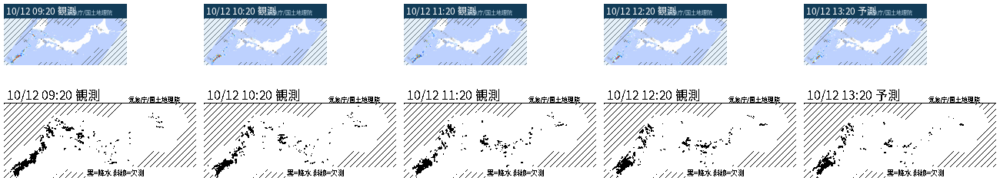

# 気象庁・雨雲画面実験

[要件定義書](../../docs/requirements/README.md)の U-10（検証開始時はドラフト v0.15） を、既存サービスや端末に接続せず検証した。画像は実機表示ではなく PNG のプレビュー。

## 再現

既存の Python 3、`requests` 2.31.0、Pillow 10.2.0、Noto Sans CJK を使用。追加インストールは不要だった。

```bash
python3 experiments/jma-radar-render/render.py
# 保存済みの一覧・背景・降水・欠測データだけで再描画（HTTP 0件）
python3 experiments/jma-radar-render/render.py --generation experiments/jma-radar-render/data/20261012T032404Z
```

新規実行は UTC 時刻の1世代に、N1/N2 原本、公式画面の設定 XML、取得タイル・欠測 GeoJSON、HTTP メタデータ、各時点の PNG、コンタクトシートを保存する。背景タイルは世代内で1回だけ取得し共有。時刻一覧をまたいだ混合はしない。

## 時刻と要素の検証

- 気象庁の[高解像度降水ナウキャスト説明](https://www.jma.go.jp/jma/kishou/know/kurashi/highres_nowcast.html)と[雨雲の動き画面](https://www.jma.go.jp/bosai/nowc/)を参照。[N1](https://www.jma.go.jp/bosai/jmatile/data/nowc/targetTimes_N1.json) は37個の観測時刻 00:20〜03:20 UTC（3時間）、[N2](https://www.jma.go.jp/bosai/jmatile/data/nowc/targetTimes_N2.json) は12個の予測時刻 03:25〜04:20 UTC（1時間）だった。時刻一覧の `elements` に `hrpns`・`hrpns_nd` があることを確認した。
- 最新観測 03:20 UTC を基準に、JST 09:20、10:20、11:20、12:20 の観測と、同じ `basetime` からの 13:20 予測を選んだ。各時点は一覧に実在し、隣接は厳密に1時間。範囲端では選択しない（循環しない）。存在しない時刻を補間・合成していない。
- 気象庁画面の[公開設定 XML](https://www.jma.go.jp/bosai/nowc/table/nowc.properties__7d6f7d8dc6f16a416574.xml)に `dataRootUrl=../jmatile/data/nowc`、`hrpns` の `minZoom=4` があり、画面の[公開 JavaScript](https://www.jma.go.jp/bosai/jmatile/js/jmatile.bundle__6888179e2a40840a12d6.js)に `{basetime}/none/{validtime}/surf/{id}/{z}/{x}/{y}.png` の組立規則がある。これに従う降水強度 `hrpns` を取得し、1時間降水量など別要素は使用していない。
- zoom 4、経度125〜148度・緯度24〜47度の2×2タイルだけを各時点に使用。背景は画面 XML で指定された気象庁配信の地理院淡色地図 `pale2`。降水タイルの透明部分だけでは無降水と判定せず、別要素 `hrpns_nd` の GeoJSON で欠測領域を斜線にした。予測だけを観測と区別して表示。
- HTTP 32件はすべて 200（時刻一覧2、公式 XML 1、背景4、降水20、欠測5）。保存済み世代の再実行は HTTP 0件で成功。詳細は [`manifest.json`](data/20261012T032404Z/manifest.json)。
- 各時点で LCD `RGB` 160×80 と E-ink `1`（厳密1bit）250×122 の PNG を再読込し、サイズ・モードを検証。コンタクトシートを実際に開き、日本列島の輪郭、色付き降水域、斜線の欠測域、日時と観測／予測の表示を目視確認した。日本列島の南西〜北東方向を狭い横長画面に収めるため、地図・降水・欠測を一緒に35度回転している。



原寸の例: [LCD 最新観測](data/20261012T032404Z/lcd-03-20261012032000.png)、[E-ink 最新観測](data/20261012T032404Z/eink-03-20261012032000.png)。全時点の原寸 PNG は同じデータ世代ディレクトリにある。

## 出典・利用条件・制約

降水データは[気象庁](https://www.jma.go.jp/jma/kishou/info/coment.html)、背景地図は[国土地理院の地理院タイル・淡色地図](https://maps.gsi.go.jp/development/ichiran.html)を気象庁サイト経由で取得した。画像内にも両機関を表示。地理院タイルの[利用案内](https://maps.gsi.go.jp/development/ichiran.html)と[コンテンツ利用規約](https://www.gsi.go.jp/kikakuchousei/kikakuchousei40182.html)に従って扱うこと。気象庁の公開画面用 URL の継続性や SLA は確認されていない。

全国を1画面に縮小するため、小さな雨域や強度の差は読みにくい。E-ink の黒い降水域は細い地図線と近接し得るので、白い縁を設けた。欠測 GeoJSON は今回確認した「外周世界ポリゴンと観測可能域の穴」という形式を使い、形式が変わる場合は描画規則の再検証が必要。観測・予測の内容と 1 時間先の有無は取得時刻で変化する。レーダー休止や偽エコーなどの注意点は[気象庁の説明](https://www.jma.go.jp/jma/kishou/know/kurashi/highres_nowcast.html)に従う。実機表示・転送速度、定期更新、別地域の操作連携は未検証。
