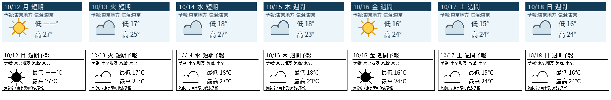

# 気象庁・東京駅向け天気画面実験

[要件定義書](../../docs/requirements/README.md)の U-10（検証開始時はドラフト v0.15） を、既存サービスや端末に接続せず検証した。画像は実機表示ではなく PNG のプレビュー。

## 再現

既存の Python 3、`requests` 2.31.0、Pillow 10.2.0、`/usr/share/fonts/opentype/noto/NotoSansCJK-Regular.ttc` を使用。追加インストールは不要だった。

```bash
python3 experiments/jma-weather-render/render.py
# 同一取得世代の保存済み JSON から、HTTP なしで再描画
python3 experiments/jma-weather-render/render.py --generation experiments/jma-weather-render/data/20261012T032152Z
```

新規実行は UTC 時刻の世代ディレクトリを1つ作り、取得した原本 JSON と HTTP メタデータ、結合結果、LCD・E-ink それぞれの日別 PNG、コンタクトシートを同じ世代へ保存する。`--generation` は原本を再利用し、再取得・時刻混在をしない。

## 2026-10-12 の実取得結果

- [気象庁・東京都予報 JSON](https://www.jma.go.jp/bosai/forecast/data/forecast/130000.json) を 03:21:52 UTC に HTTP 200 で取得。短期・週間とも発表時刻は 2026-10-12 11:00 JST。詳細は [`manifest.json`](data/20261012T032152Z/manifest.json)。
- 東京駅の初期地点は、予報区域 `東京地方` (`130010`) と気温代表地点 `東京` (`44132`) に対応付けた。東京駅そのものの地点予報とは表示しない。
- JST 日付で 10/12〜10/18 の7日が揃った。天気コードは当該日の短期予報を優先し、以後は週間予報を利用。気温は短期の00時枠を最低、09時枠を最高として日付を照合し、利用できない欄だけ週間へ引き継いだ。発表前の当日00時枠は今日の最低予報に流用しない。
- 今日の最低気温だけ予報値が欠損し、画像で `ーー` とした。最高は短期09時枠の 27 ℃。湿度欄は予報 JSON に無いため非表示。観測値から補完していない。結合根拠と個別フィールドの出所は [`derived-days.json`](data/20261012T032152Z/derived-days.json)。
- 7枚ずつの LCD `RGB` 160×80、E-ink `1`（厳密1bit）250×122 を PNG として再読込し検証。Noto Sans CJK の日本語が豆腐にならず、日付・予報区域・気温地点・天気マーク・最低最高が読めることをコンタクトシートで目視確認した。



原寸の例: [LCD 今日](data/20261012T032152Z/lcd-00-2026-10-12.png)、[E-ink 今日](data/20261012T032152Z/eink-00-2026-10-12.png)。各日の全原寸 PNG は同じデータ世代ディレクトリにある。

## 制約

今回の実データ・東京の設定だけを検証した。別地域への対応、1時間ごとの運用、通信・端末での色再現や描画時間は未検証。気象庁の公開 JSON は固定 API/SLA として保証されていない。天気マークは気象庁の3桁コードの主分類（晴・曇・雨・雪）を小画面向けに簡略描画したもので、詳細な時間変化は表現しない。データ出典は[気象庁](https://www.jma.go.jp/jma/kishou/info/coment.html)。
