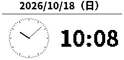

# 時計プラグイン検証・反映記録（2026-10-18）

## 作業範囲

既存リポジトリのHEADは `26b6c87`、着手時の未コミット差分はなし。リポジトリ内／親階層にAGENTS.mdや.agents/skillsは見つからず、`/home/tane/.codex/AGENTS.md` の日本語指定に従った。サービス／プラグイン構造、共通状態、要件・設計、E-inkの現行実装とローカルV4参考コードを確認した。

書込み可能な作業領域に追跡ファイルだけをコピーし、稼働DB・設定・秘密ファイルを複製せずに検証した。元リポジトリへ反映するときは対象ごとの元ファイルSHAを照合し、並行変更があればコピー前に中止する。ビルド成果物や私有設定はソース差分に含めない。

主な変更は時計固有の描画・端末設定、新しい共通時刻依存フックと分境界worker、既存順序の末尾追加移行、Webメニュー・設定、能力交渉付きフレームメタデータ、V4時計専用base／partial更新である。共通端末設定とPico NVMの形式、動画仕様は変更しない。

## 自動検証

- Rust all-targets：209件成功、失敗0、外部HTTPS 1件ignore（lib 204、server 1、保存済みJMA 4）。
- Web UI：27件成功（時計3、既存サムネ5、動画削除13、FPS 6）。
- Firmwareホスト：28実行がPASS。E-ink_0／1のbase・部分・全面・復帰と実メインループのメタデータ検証を含む。
- FirmwareサンプルUF2：E-ink_0、E-ink_1、sample-a（LCD）の3種がビルド成功。
- PNG目視：通常10:08、年末23:59、年始00:00のLCD／E-inkを確認。日付・曜日と両時計の配置、文字・針の欠けなし。
- fmt check成功、all-targets clippy `-D warnings` 成功。lint修正はテストの配列検索式のみで、該当の時計描画テスト3件も再成功。

- Rust：`cargo test --offline --manifest-path service/Cargo.toml --all-targets`。localhost模擬端末以外への接続は不要。既存のlive HTTPS試験はignoreのまま。
- Rust：`cargo fmt --manifest-path service/Cargo.toml --check`、`cargo clippy --offline --manifest-path service/Cargo.toml --all-targets -- -D warnings`。
- Web UI：`service/tests/*.test.cjs` を各々 `node` で直接実行。新規3件を含め、既存サムネ・動画削除・FPSも確認する。
- Firmware：`bash firmware/tests/run_host_tests.sh`。V4の両RAM書込み、変化する画像のSPI順序、9回部分更新→10分境界全面、設定15分、時計以外のfull/sleep、初回・復帰・逆行・BUSYエラーのbase再生成、実メインループの新旧受信／CRC／ACKを確認する。
- ビルド：`bash firmware/tools/build.sh --device E-ink_0 --sample`、`E-ink_1 --sample`、`sample-a --sample`。これらはダミー設定のコンパイル確認専用UF2で、書込み禁止。

時計のテストは全曜日、日・年・閏日境界、00〜23時、時針の分位置、秒による画像不変、ネイティブ解像度・パディング、文字境界、表示直後と再接続、分境界・重複・遅れ・送信待ち、他プラグイン／待機／メニュー／ローカル所有／オフラインへの無更新、設定の競合・永続化・端末削除、既存選択・ON/OFF・順序保持を対象とする。

## 描画サンプル

`cargo run --offline --manifest-path service/Cargo.toml --example clock-preview -- /tmp/picomado-clock-previews` はアプリDBやネットワークを使わず、通常10:08、23:30、12/31 23:59、1/1 00:00のLCD／E-ink PNGを生成する。ネイティブ寸法と拡大PNGを同時に出力する。代表PNGを `assets/clock-lcd-preview.png`、`assets/clock-eink-preview.png` に保持する。実パネルの残像やちらつきの検証画像ではない。

## 変更反映手順（初期検証時点。実施結果は末尾）

1. サーバ反映の明示指示後、既存サービス構成・保存先を確認し、現在の実行ファイルと共通SQLiteをSQLite整合性の保たれる方法で退避する。反映直前のサービス停止・起動もその指示範囲で行う。DBだけをファイルコピーする場合は停止・checkpointとWALを考慮する。
2. 既存Rust環境で候補サーバをオフラインのReleaseビルドにする。稼働実行ファイルを置換し、既存サービスを起動する。既存config、端末設定、プラグイン資産を上書きしない。
3. 初回起動で旧4種順序の末尾に時計が加わる。既存端末の選択とON/OFFが以前のままであることをWebで確認する。ユーザーの指示を受けた端末だけ時計をONにする。
4. 時計画像だけならLCD／旧E-inkとも既存ファームで表示可能。E-inkのフラッシュ抑制には新ファームが必要。旧ファームのWeb表示は未対応を示す。
5. E-inkの対象端末とBOOTSELが明確になってから、その個体のconfig・Flash ID・build manifestを照合して通常のビルド／書込み手順を実行する。今回のsample UF2は使用しない。LCDの時計のためのファーム更新は不要。
6. 実機で現在時刻・曜日、直後の分境界、10分境界、変更した間隔、切替・待機復帰・再接続、天気等へ戻した際の全面更新、残像とBUSY時間を確認する。複数端末の独立表示と動画への非影響も確認する。
7. 旧バイナリは5種順序を読めないため、ロールバックには退避した旧バイナリと移行前DBを対で使う。移行後の運用変更を失わないよう実施前に差を確認する。

初期の実装検証段階では本番反映・書込みを実施しなかった。その後の明示指示に基づく実施結果を以下に記録する。以下の未コミット表記は当時の状態であり、後のユーザー指示によるソース保存の区切りは docs/history/verification-cut-2026-10-18.md を参照する。SSHとpushは行っていない。

## サンプル成果物（書込み禁止）

作業コピーの `firmware/build/.samples/` に保持する。実個体の秘密設定・Flash IDを含まない。

| 対象 | UF2バイト数 | SHA-256 |
| --- | ---: | --- |
| E-ink_0 | 723456 | `259436614e0639d8c26d3912c67a2ea3f6212e623c7a0954a0076de8ac0b7f11` |
| E-ink_1 | 726016 | `d25583b5f42c23bc708dbeb5dd502f37618a16421c67d0b5e7e088ae4a287805` |
| sample-a（LCD） | 723968 | `964d233e9bdf558988e533eac4826c0c19f6b5c06abd51c6f5d9987727835914` |

検証ログは `/tmp/picomado-clock-cargo-test.log`、`/tmp/picomado-clock-ui-tests.log`、`/tmp/picomado-clock-firmware-tests.log`、`/tmp/picomado-clock-clippy-final.log`、`/tmp/picomado-clock-fmt.log`。一時ディレクトリのログは再起動等で消える可能性があるため、結果は本記録へ確定値を残す。

## 本番反映・E-ink_0／1書込み（2026-10-18追加）

ユーザーの本番反映指示、および「E-ink_0 Bootselしました」の明示を受けて実施した。サンプルUF2は使用せず、その後の別途指示でE-ink_1も更新した。LCDには書き込んでいない。SSH・コミット・pushは実行していない。

- 本番サーバ：`2026-10-18 14:43:27 JST` 起動、PID `907828`、active/running。起動2分後の確認でも同じPID、`NRestarts=0`。
- Releaseビルド：現行と同じ `caricature-retention-delete` を有効化。実プロセスの `PICOMADO_CARICATURE_DELETE=1` も維持。
- 実行中バイナリSHA-256：`a1edb213288fcb8727cd6ebb6a4a8e4ad1b54b0a07830d25bc8dc8bef5468337`（15,781,648 byte）。候補、インストール先、`/proc/<PID>/exe` が一致。
- 既存config・systemd unit・drop-inはSHA一致。Cargo登録の機能と他バイナリは変更せず、サーバ実行ファイルだけを原子的に置換した。
- サービス停止後、SQLite backup APIでDBを整合的に退避し、quick_check=okを確認。退避したのはDB 1,982,464 byteと旧バイナリ15,580,160 byte、最小manifestだけ。画像／動画／全データのコピーは作っていない。
- 退避先：`/home/tane/.config/PicoMado/data/rollback-clock-20261018T054326Z/`。旧バイナリSHAは `4a52894aaa7eeb65ad7c1a7f2a2daf0fe38c3d8801b485074de59dd82e8385b6`。
- 更新直前の停止時DBを正本として比較し、登録incarnation・選択・有効プラグインの差分0。共通順序は `weather → rain-radar → caricature → youtube` を保って時計のみ末尾へ追加した。停止時の選択は E-ink_0＝風刺画、E-ink_1＝天気、LCD＝YouTubeだった。
- 作業中に利用設定が別操作で変更されることを検知したため、初回読取り時の設定へ戻す操作はしていない。更新直後の差分0を確認後、LCDが時計へ切り替わったことを読取りで確認した。こちらから端末の選択・ON/OFF・時計間隔を書き換えるAPIは呼んでいない。
- `/`、`/plugins/clock`、`/api/plugins/clock`、`/api/state` はHTTP 200。時計APIは `Asia/Tokyo`、`HH:MM`、60秒更新を返し、登録端末の時計設定は10分・revision 1。
- 起動後357行の確認区間でpanic/error/timeout等は0件。E-ink両機とLCDの再接続・RenderedAckを確認。
- LCD時計は表示開始時 `14:44:16` と分境界 `14:45:00` の送信を確認。後者のRenderedAckは `14:45:04` で、実機配送／完了応答には約4秒の遅れを観測した。送信時刻の分境界は確認できたが、物理表示の正確な完了時刻・遅れの原因は未確定で、過去からのLCD通信課題と混同せずユーザー確認を残す。

E-ink_0は実configとFlash ID `E6614864D3813227`、唯一のBOOTSEL端末、manifestとUF2 SHAを照合し、load/verify/起動を完了した。UF2 SHA-256は `2136bf3954b3e05cf78c1dabd4c53bf8d615a9802f334f9831795772259a7399`（723,456 byte）。USBシリアルの同ID再認識、ACTIVE/READYの診断、サーバの `eink-clock-v1` 申告と描画完了ACKを確認した。時計へ強制切替はしていないため、部分更新の見た目・残像・10分全面更新はユーザーテストで確認する。

その後、ユーザーから「E-ink_1 Bootselしました」と明示されたため、E-ink_1も実configとFlash ID `E6614864D34F8E22`、唯一のBOOTSEL端末を照合してload/verify/起動した。SHA-256は `397115122bca8c1e6db781ea10602954461292184c17759d7bc094698aa7ef38`（726,528 byte）。`14:48:53 JST` に `eink-clock-v1` 付きで再接続し、`14:48:58` にframe 288395の描画ACKを確認した。USBの同ID再認識とACTIVE/READY診断も確認した。サーバは同じPID `907828`、再起動回数0を継続している。LCDの時計用ファーム更新は不要。

追加確認の `14:50 JST` 時点では全3台がonline。ユーザー操作によりE-ink_1とLCDが時計を選択している。こちらから選択・有効化を変更していない。LCDは14:48・14:49の各00秒に送信とRenderedAckを確認した。

初期357行の確認区間の後、`14:46:24` にE-ink_0のframe 288391で描画ACK待ち切れを1回記録した。`14:46:32` に自動再接続し、frame 288392を `14:46:41` に描画完了、以後heartbeatを継続している。原因は未確定で、USB差し替えや部分更新との因果は断定していない。現時点のE-ink_0は風刺画表示でonline、両ACK済み。従って全期間を「異常なし」とは報告せず、この一過性の待ち切れと自動回復を留保する。

## Library共有

代表PNGをLibraryへ保存し、Library readで取得できることを確認した。

- LCD：`libfile_d631924c94448191ab74fc345967b3b0`／`file_00000000707482308ea73a5d80b1e42c`、version 0。
- E-ink：`libfile_6d0d06ceca288191802c41c9e3956309`／`file_000000003a3882309496f24bfce510e8`、version 0。

本記録はLibraryの `libfile_1d09a7376be081918ca44168de2d2c16` に保存し、E-ink_1の追加結果を同じIDの新バージョンへ反映する。ローカルパスをクラウドから読めると仮定せず、Libraryのローカルファイル転送対応操作で実バイトを保存した。
